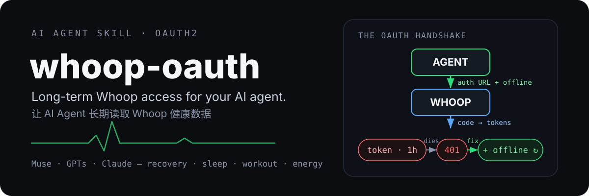

<p align="center">
  
</p>

**[English](./README.md) | 简体中文**

[](./LICENSE)


## 这是什么

一个 `SKILL.md`，手把手教 AI agent 通过 OAuth2 接入 Whoop——而且接入之后**长期保持在线**，让 agent 能长期读取恢复、睡眠、训练和能量消耗数据。平台中立：按 Meta Muse 的接入方式编写，但 OpenAI GPTs / Claude 的开发者可以换成自己的 OAuth 流程（skill 里 Muse 专属部分标了 `[Muse]`）。

## 经过实战检验，而非纸上谈兵

这份 skill 是 2026 年 10 月接通 Whoop **三次实战**的完整复盘，包含两次完整的「踩坑—修复」：

- **第 1 次** 死于 401——查出来是 `token_endpoint_auth_method` 默认用了 `client_secret_basic`，换成 `client_secret_post` 就通了。
- **第 2 次** 工作了约 1 小时，然后死了——access token 没有 refresh token，因为 scope 里没有 `offline`（Whoop 后台压根没有这个复选框，必须手写进授权 URL）。
- **第 3 次** 把完整修复链端到端验证了一遍：授权只用了约 2 分钟，**发放 80 分钟以上**后自动续期依然生效。

## 为什么要写这个

下面两点官方文档都没讲清楚，但第一次接入的人都会踩：

1. **`token_endpoint_auth_method` 必须设为 `client_secret_post`。** OAuth 默认的 `client_secret_basic` 打 Whoop 的 token 接口只会返回一个光秃秃的 401。client secret 必须放在 POST 请求体里，而不是 `Authorization` 请求头。
2. **必须手动把 `offline` 加进授权 URL 的 scope。** Whoop 开发者后台没有 `offline` 这个复选框。不加的话，你拿到的 token 大约 1 小时就过期，而且**没有 refresh token**——一小时后连接静默死亡。

另外一个值得知道的坑：Whoop 的创建应用表单不会校验 client secret。输错了你也不会立刻发现，直到换 token 时报 401 才暴露。

## 快速上手

**1. 创建应用。** 在 [Whoop 开发者后台](https://developer.whoop.com/) 创建应用，把 redirect URI 设成你 agent 的 OAuth 回调地址。Muse 是 `https://agent.meta.ai/api/hatch/oauth/callback`。还需要一个公开的隐私政策页面——这是 Whoop 应用上架的硬性要求。

**2. 用精确参数拼接授权 URL。** 带上你的 client ID、redirect URI 和全部七个 scope——`offline` 别漏：

```text
https://api.prod.whoop.com/oauth/oauth2/auth
  ?client_id=YOUR_CLIENT_ID
  &redirect_uri=YOUR_REDIRECT_URI
  &response_type=code
  &scope=offline+read:recovery+read:cycles+read:sleep+read:workout+read:profile+read:body_measurement
```

**3. 用户授权。** 大约 2 分钟。用户点同意后，你的回调地址会收到一个 `code`。

**4. 用 code 换 token。** 注意：`client_secret` 放在 POST 请求**体**里（`client_secret_post`）——不是请求头：

```bash
curl -X POST https://api.prod.whoop.com/oauth/oauth2/token \
  -H "Content-Type: application/x-www-form-urlencoded" \
  -d "grant_type=authorization_code" \
  -d "code=YOUR_CODE" \
  -d "redirect_uri=YOUR_REDIRECT_URI" \
  -d "client_id=YOUR_CLIENT_ID" \
  -d "client_secret=YOUR_CLIENT_SECRET"
```

**5. 验证自动续期。** 等 **70 分钟以上**再调一次 API。如果不用重新授权就能通，续期就是活的，连接长期有效。个人使用场景不需要 webhook。

## 排障

| 现象 | 原因 | 修法 |
|---|---|---|
| 换 token 时 401 | secret 放进了 `Authorization` 请求头（`client_secret_basic`） | 把 `client_id`/`client_secret` 改放到 POST 请求体里 |
| 能用，然后大约 1 小时后死了 | 授权 URL 的 scope 里没有 `offline`，没有 refresh token | 把 `offline` 加进 `scope`，重新走一次授权 |
| 刚建完应用就 401 | client secret 输错了——后台表单不会校验 | 核对 secret，必要时重新注册应用 |
| `/sleep`、`/workout`、`/recovery` 返回 404 | 查询的时间段里没数据 | 不是报错——通常只是晚上没戴手环 |

## 接通之后

API 根地址：`https://api.prod.whoop.com`

| 接口 | 拿到什么 |
|---|---|
| `/user/profile/basic` | 用户档案 |
| `/user/body_measurement` | 身高、体重、最大心率 |
| `/cycle` | 生理日（睡到睡——可能跨自然日）；每天的 strain 和总能耗 |
| `/recovery` | 恢复分、HRV、静息心率 |
| `/sleep` | 睡眠表现、睡眠分期、睡眠效率 |
| `/workout` | 记录的训练活动，带 strain 和能耗 |

列表接口每页 **limit 25**，用 `nextToken` 翻页。recovery / sleep / workout 为空，几乎都意味着晚上没戴手环——把"没数据"当成"没数据"，不是报错。

## 限制与说明

- skill 只读数据，不写 Whoop、不改用户设置。
- **永远不要提交 client secret**——skill 里所有凭证都走 agent 的安全 OAuth 通道，不会经过聊天记录或文件。
- token 寿命约 1 小时；skill 依赖 `offline` scope 的 refresh token，而不是反复重新授权。
- Muse 专属的配置步骤在 skill 里标了 `[Muse]`；其他 agent 换成自己平台的 OAuth 流程即可。

## 开源协议

[MIT](./LICENSE)——拿去用，不客气。
